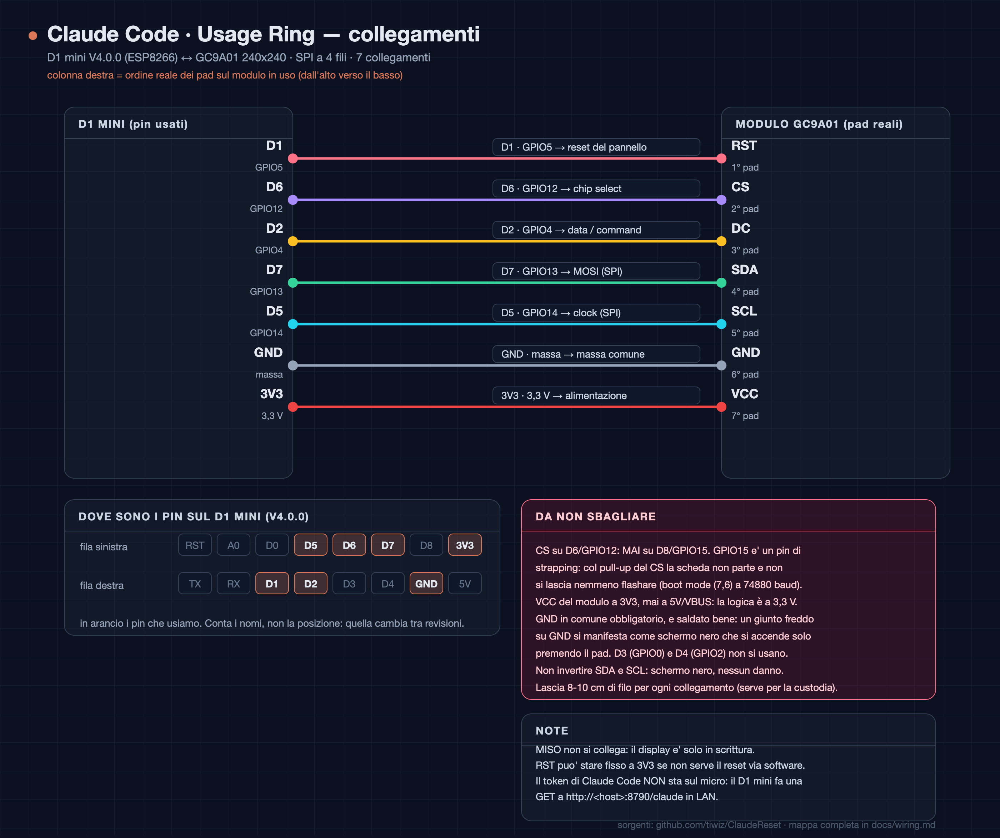

# ClaudeReset

A desk gauge that shows how much of your **Claude Code** quota you have used, and when the window
resets — no browser, no terminal, no `claude /usage`.



A **LOLIN D1 mini (ESP8266)** drives a **round GC9A01 240×240** SPI panel: a progress ring, the
percentage in the middle, the reset time and a live countdown underneath. It refreshes every 30 s.

## Why it is split in two parts

The OAuth token must never live on a microcontroller: a desk object is easy to pick up, its flash is
easy to read, and that token spends your quota. So the secret stays on a machine that can keep it,
and the display only ever sees a number.

```
┌────────────────────────────────────┐        ┌───────────────────────┐
│  ClaudeReset service (Docker)      │        │  D1 mini + GC9A01     │
│  own Claude sign-in, PKCE          │        │  finds it over mDNS   │
│  refreshes the tokens for you      │───────▶│  GET /api/usage       │
│  polls Anthropic every 5 min       │  LAN   │  draws every 30 s     │
│  caches and serves the numbers     │        │  no secrets on board  │
└────────────────────────────────────┘        └───────────────────────┘
```

- **The service** signs in to Claude on its own (no CLI, no credentials file of yours), keeps the
  tokens in a 600 file inside a Docker volume, refreshes them before they expire, tells you when the
  refresh token itself will expire, and serves a compact JSON on the LAN. It also announces itself
  over mDNS, so nobody has to write an IP address into the firmware.
- **The firmware** is a dumb client: a plain HTTP GET on the LAN, then it draws. No secrets on the
  device, nothing to leak.

> `poller/` + `systemd/` are the older single-host variant: it reads the credentials file of a Claude
> Code install on the same machine and *does not refresh anything* — it depends on the CLI being used.
> Fine if that is your setup, superseded by the service for everybody else.

### Quick start

```bash
git clone https://github.com/tiwiz/ClaudeReset.git && cd ClaudeReset/service
mkdir -p data && chown 10001:10001 data
docker compose up -d --build
# open the dashboard from the LAN address you will keep using, then sign in
```

Full details, endpoints, polling policy and security notes: [service/README.md](service/README.md).

## Display layout

| Element | Value |
|---|---|
| Ring track | `circle r=103`, 14 px thick, `#2b2b33` |
| Progress arc | from 12 o'clock, clockwise, `360° × pct`, `#d97757` (`#e05a3a` above 80%) |
| Window label | `7g` (7 days) at y 62, `FreeSansBold12pt` |
| Percentage | y 118, `FreeSansBold24pt` |
| Reset clock | `reset HH:MM` at y 169, `FreeSansBold9pt` |
| Countdown | `2h 41m` at y 191, `FreeSans9pt` |
| Text colour | pure white `#ffffff` on all lines |
| Offline state | grey ring, `--` in the middle, reason printed on the reset line |

The gauge shows the **7-day window** by default because that is the one you can actually run out of
over a week; the 5-hour window is still published and only needs a one-line change in
`firmware/src/main.cpp` (`p7`/`r7` → `p`/`r`).

## JSON contract

The service and the legacy poller speak the **same compact payload**: the display does not care which
one answers it. Only the paths differ.

| Endpoint | Returns |
|---|---|
| `GET /api/usage` (service) · `GET /claude` (legacy) | compact JSON for the microcontroller (keys below) |
| `GET /` | service: the dashboard · legacy: a human-readable summary |
| `GET /health` | 200 when the reading is fresh, 503 when it is stuck (`age`, `err`) |

```json
{"ok":1,"p":14.0,"r":9206,"p7":65.0,"r7":14006,"age":21,"stale":0,"err":""}
```

| Field | Meaning |
|---|---|
| `ok` | 1 when there is a usable reading |
| `p`, `r` | 5-hour window: used percentage, seconds until it resets |
| `p7`, `r7` | 7-day window: same two values (what the display shows) |
| `age` | seconds since the reading was taken |
| `stale` | 1 when the reading is older than `STALE_SECONDS` |
| `err` | last error in plain words (e.g. `token scaduto`) |

A stale or missing value is a **visible** state on purpose: a display that keeps showing the last
number as if it were live is worse than a display that says "I do not know".

## Hardware

| Part | Notes |
|---|---|
| LOLIN D1 mini V4.0.0 | ESP8266EX, USB-C, CH340 |
| Round GC9A01 module | 1.28", 240×240, 4-wire SPI, **7 pads**: `RST · CS · DC · SDA · SCL · GND · VCC` |
| 7 jumper wires | 8–10 cm each, so the board can go back into a case |
| USB supply | 5 V from any charger; 3.3 V for the panel comes from the board |

| Pad on the module | D1 mini | GPIO | Notes |
|---|---|---|---|
| `RST` | `D1` | GPIO5 | panel reset |
| `CS` | `D6` | GPIO12 | chip select — **never `D8`** |
| `DC` | `D2` | GPIO4 | data/command |
| `SDA` | `D7` | GPIO13 | MOSI (hardware SPI) |
| `SCL` | `D5` | GPIO14 | clock (hardware SPI) |
| `GND` | `GND` | — | common ground |
| `VCC` | `3V3` | — | 3.3 V only |

### Two traps that cost real time

1. **`CS` on `D8`/GPIO15 does not work.** GPIO15 is a boot strapping pin and it must be low at boot;
   these modules have a pull-up on `CS`, so the board neither boots nor accepts a flash. The symptom
   is `Failed to connect to ESP8266: Timed out waiting for packet header` from esptool, which sends
   you hunting for cables and drivers. Proof, reading the boot ROM at 74880 baud:
   `boot mode:(7,6)` instead of `boot mode:(3,6)`. Use `D6`/GPIO12, or tie `CS` to GND with
   `-DTFT_CS=-1` when the display is the only device on the bus.
2. **Solder joints on `VCC` and `GND`.** These are the only two pads that carry current. A dry joint
   on `GND` shows up as a black screen that lights up *only while you press the pad with a probe* —
   it is not the probe feeding it (a voltmeter is ~10 MΩ), it is the pressure restoring contact.

## Poller setup

```bash
git clone https://github.com/tiwiz/ClaudeReset.git && cd ClaudeReset
cp .env.example .env                        # paths, port, intervals
mkdir -p ~/.config/systemd/user
cp systemd/claude-usage.service ~/.config/systemd/user/
systemctl --user daemon-reload
systemctl --user enable --now claude-usage.service
curl -s localhost:8790/claude | python3 -m json.tool
```

`loginctl enable-linger <user>` is required for the user unit to start at boot. With `ufw`:
`sudo ufw allow from <your-lan>/24 to any port 8790 proto tcp`.

Run it in the foreground for testing with `python3 poller/claude_usage.py`.

## Firmware

```bash
cd firmware
cp include/config.h.example include/config.h   # wifi + device name, then chmod 600
~/.venvs/pio/bin/pio run                       # build
~/.venvs/pio/bin/pio run -t upload             # flash (board on USB)
~/.venvs/pio/bin/pio device monitor            # serial log at 115200
```

Two builds come out of the same sources:

| Environment | Contains | Used for |
|---|---|---|
| `d1_mini` | whatever `config.h` says (WiFi, names) | flashing your own board over USB |
| `flasher` | **no credentials at all** | the image the web flasher publishes |

The `flasher` build compiles with `-DCLAUDE_RING_PUBLIC_BUILD=1`, which skips `config.h`
entirely; `include/config_defaults.h` (committed) supplies every non-secret default. The WiFi is
then handed to the board by the browser over the serial cable (Improv protocol) and stored in
EEPROM, so it survives a reboot. Verified automatically: the check in
`firmware/lib/improv/README.md` note aside, the release recipe compares the strings of the private
and public images and refuses a public image that contains any of the credentials.

`lib/improv/` is the Improv serial library, vendored with one fix: it declares ESP8266 support but
includes ESP32-only FreeRTOS headers for the single `delay` it needs. See `lib/improv/README.md`.

TFT_eSPI is configured entirely from `build_flags` in `platformio.ini` (`-DUSER_SETUP_LOADED=1`
plus the driver and pin defines), so no library file is ever edited. There is no framebuffer:
240×240 at 16 bpp is 115 kB and the ESP8266 has ~40 kB free, so primitives are drawn directly and
only the delta is repainted.

### Optional button

A momentary contact between **D0 / GPIO16** and **3V3** flips the dial between the 7-day and the
5-hour window. Both windows already arrive in the same JSON, so the switch costs no request and no
wait. GPIO16 is the one pin with an internal pull-down: no resistor, and an unwired pin stays quiet
instead of flipping the view on noise. The choice is kept in EEPROM, so it survives a reboot.
Full wiring notes (and why not D3/D4/D8) in `docs/wiring.md`.

### How the display finds the service

No IP address is compiled in. The firmware asks the LAN who offers `_claudereset._tcp`
(`MDNS.queryService`, DNS-SD, up to 3 s) and takes **address and port from the announcement**, so the
service can move host without anyone re-flashing a board. `FALLBACK_HOST` in `config.h` is only used
when nothing answers the announcement. After three failed fetches in a row the display drops the
address it had and asks again — that is a service that moved, not a dead display.

```
[mdns] mi presento come claude-ring.local
[ntp] orario sincronizzato
[mdns] claudereset trovato su 192.168.86.42:8790
[poll] {"v": 1, "ok": 1, "p": 21.0, "r": 640, "p7": 66.0, "r7": 5440, "age": 300, "stale": 0, "err": ""}
```

If the service has no sign-in yet, or its token expired, the display says so on the reset line
(`non autenticato`) instead of repeating the last number as if it were current.

### Diagnostics

`firmware-test/` is a separate PlatformIO project that cycles solid colours, the four rotations and
a test dial, **without WiFi and without `config.h`**. It answers one question in a single flash: is
the panel alive at all?

```bash
cd firmware-test
pio run -e gc9a01 -t upload     # expected driver
pio run -e st7789 -t upload     # if the module turns out to be a different controller
pio run -e ili9341 -t upload
```

No glow at all from a powered module (they have no backlight pin — the LED is wired to `VCC`
internally) means the problem is power, not drivers. More detail in `docs/wiring.md`.

## Web flasher

**<https://tiwiz.github.io/ClaudeReset/flasher/>**

Flash the display from a browser — no toolchain, no build machine. It ships the credential-free
image, and the WiFi is entered in the dialog and sent over the cable. Needs Chrome, Edge or Opera on
a desktop: Web Serial does not exist in Safari, Firefox or on phones.

Two things the browser cannot do for you, and are therefore baked into the published file: the
ESP8266 image header must already carry flash mode/size/frequency (it is `e9 02 02 40` — DIO, 4 MB,
40 MHz), and the manifest must declare one image at offset 0.

## Repository layout

| Path | Role |
|---|---|
| `service/` | the LAN service: own Claude sign-in, token refresh, cache, mDNS (Docker) |
| `poller/claude_usage.py` | legacy single-host variant: reads Claude Code's token file, serves JSON |
| `systemd/claude-usage.service` | user unit for the legacy poller |
| `firmware/` | ESP8266 firmware (PlatformIO + TFT_eSPI) |
| `firmware-test/` | display test patterns, no WiFi, no secrets |
| `docs/index.html` | landing page for GitHub Pages |
| `docs/flasher/` | the web flasher page, its manifest and the published image |
| `docs/wiring.md` | pin map, dial geometry, palette, troubleshooting (Italian) |
| `docs/wiring-diagram.png` | the wiring sheet |
| `firmware/lib/improv/` | Improv serial protocol (MIT), vendored with an ESP8266 include fix |

## Secrets

- The OAuth token is **not** in this repository: with the service it lives in a mode-600 file inside
  a Docker volume; with the legacy poller it is read at runtime from Claude Code's own credentials
  file. Either way it is never logged and never sent to the display.
- `.env` and `firmware/include/config.h` hold local configuration (paths, port, wifi) and are
  git-ignored; only the `.example` files are committed.
- `CLAUDE_OAUTH_TOKEN` exists for testing and lives in `.env` only.

## Status

- [x] firmware on real hardware: panel, wifi, NTP, live values every 30 s
- [x] 7-day window, pure white text, verified against the real Claude Code quota
- [x] service with its own sign-in, token refresh, cache and mDNS advertisement (34 tests)
- [x] firmware discovers the service over mDNS, verified on hardware (found `192.168.86.42:8790` by itself)
- [x] web flasher on GitHub Pages: <https://tiwiz.github.io/ClaudeReset/flasher/>
- [x] WiFi configured from the browser (Improv) for the published image — no secrets in the binary
- [x] button on D0 to switch between the 7-day and the 5-hour window (1.1.0)
- [ ] secondary arc to show both windows at once
- [ ] 3D-printed enclosure
